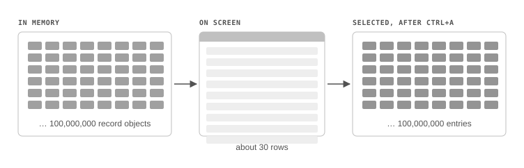
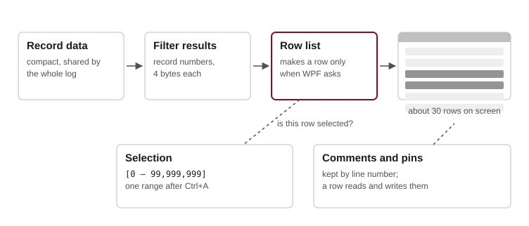
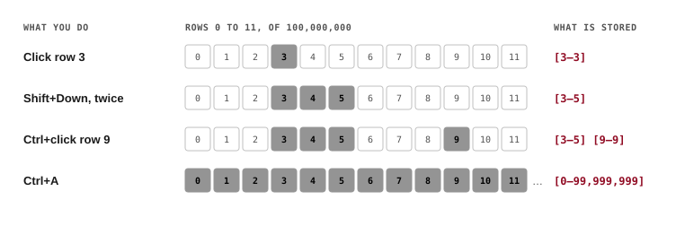

# Decision: The Row Design for Weevil 3.0

Question for #1014 (step 4 of the [#990 plan](../../../../Plans/990-ImmutableCore.md#steps)): can Weevil's grid work at 100 million rows if it keeps a row object only for the rows WPF draws, and stores the selection as ranges?

**Decided 2026-10-22: yes.** Row view-models are made only for the rows WPF asks for, and the selection is kept as ranges, with the grid handling clicks and the selection keys itself. The project owner approved it after reading the proof of concept's [results](../README.md#results), the explanation, the illustrated page and the recommendation below.

This folder holds:

| File | What it is |
|---|---|
| This file | The decision, and the explanation and recommendation it was based on, as written in the conversation that led to it |
| [RowDesign.html](RowDesign.html) | The illustrated page shown to the project owner. Open it in a browser; it follows the browser's light or dark theme. |
| [Today.svg](Today.svg), [NewDesign.svg](NewDesign.svg), [Ranges.svg](Ranges.svg) | The page's three diagrams, as images |

## The Design in Pictures

**Today, Weevil 2.12 keeps an object for every record.** WPF draws only the rows on screen, but every record is an object in memory, and Ctrl+A copies every one of them into WPF's list of selected rows.

**The new design makes a row only when WPF needs it.** The records live in a compact table, and a filter's results are record numbers. When WPF asks for a row, the row list makes a small row object for that one record, and lets it go when the row scrolls away.

**The selection is remembered as ranges.** Weevil stores where each selected stretch of rows starts and ends.

## The Explanation

The project owner asked for the design in plain English, with an illustration. This was the answer, as written; the link to the illustrated page, which is private, is replaced by its copy in this folder.

> I've made an illustrated page that explains the design: [RowDesign.html](RowDesign.html).
>
> **The short version**
>
> The grid only ever shows about 30 rows at a time.
>
> - **Today (Weevil 2.12),** every record is an object in memory, even though only 30 are drawn. When you press Ctrl+A, WPF puts all of them in its list of selected rows: 100 million entries for a 100-million-record log. After each filter, Weevil selects them all again, one at a time.
> - **The new design** keeps only the rows on screen as objects. When WPF asks for row 27,500,013, Weevil makes one small object for that row, and lets it go when the row scrolls away.
> - **The selection** is stored as where each selected block of rows starts and ends:
>
>   | You do | Weevil stores |
>   |---|---|
>   | Click row 3 | `[3–3]` |
>   | Shift+Down twice | `[3–5]` |
>   | Ctrl+click row 9 | `[3–5] [9–9]` |
>   | Ctrl+A | `[0–99,999,999]`, one entry |
>
>   Weevil handles those clicks and keys itself, instead of WPF.
>
> **What it costs**
> - Weevil now owns the selection keys. The proof of concept and your checks by hand show they behave as before.
> - Copy stops at 100,000 records and points to Export, which #990 already decided.
> - After every filter the window still pauses about a quarter of a second while WPF redraws the rows on screen. That happens with any design, and in Weevil today.
>
> The page has three diagrams, the measured numbers and the trade-offs. Once you've read it, do you approve the design for #1015?

## The Recommendation

The project owner then asked: given the code base, the goal and the test results, should Weevil keep the new design, and why? This was the answer, as written.

> Yes, keep the new design. Getting rid of per-record objects is what Weevil 3.0 is for, and the new design is the only approach tested that works without them. Here's why.
>
> **1. The alternative fails the goal of Weevil 3.0.**
> - #990 and #988 exist so that Weevil stops keeping an object for every record. That's how it will open 20 GB logs.
> - WPF's own selection needs an object for every selected row. Ctrl+A would create all of them again: about 31 GB at 100 million rows. So it isn't a matter of taste; today's approach and records-on-demand can't work together.
>
> **2. The tests back it up.**
> - 21 of 23 targets met at 100 million rows. The two misses were 257 and 258 ms against a 250 ms target, and come from WPF redrawing the rows after a filter. Any design pays that cost.
> - WPF never walked the list. Only 31 row objects were left in memory.
> - Ctrl+A took 21 ms with no extra memory, and keeping a selection across a filter took 0.3 s at worst.
> - Your checks by hand all passed.
>
> **3. It fixes a freeze Weevil has today.** Weevil 2.12 selects every selected record again, one at a time, after each filter, and the time grows with the square of the count. 8,000 selected rows took 8 s, so a large selection freezes the window today. The new design removes that.
>
> **4. It fits how Weevil is meant to be built.**
> - The selection moves into Core as ranges, so it works without the GUI (CLI, PowerShell, tests) and can be tested there.
> - It matches decisions 4 and 5 already in the #990 plan.
> - #806-style bugs mostly go away: navigation sets the selection directly, so there's no WPF quirk extending a range while Shift is held.
>
> **Risks to plan for in #1015.** None of these changes the decision.
> - **Weevil owns the selection input.** The proof of concept covered click, Shift, Ctrl, the arrow keys, Page Up and Down, Home, End and Ctrl+A. It did not cover these, which #1015 must add:
>   - Dragging the mouse to select.
>   - Right-clicking a row before opening the context menu.
>   - Keeping the anchor row after a filter.
>   - Screen-reader support: WPF will no longer report which rows are selected.
> - **Its own GUI feature tests.** #1015 should add tests for the selection journeys, because Core tests can't catch focus or key-handling regressions.
> - **It's larger than it looks,** as the plan already says. Four converters and some code-behind expect an `IRecord`. Rows also need to fit Weevil's Metalama view-models.
> - **The quarter-second pause after each filter** is a separate, optional fix. For example, Weevil could keep the list visible while it filters, rather than hiding it.
>
> **Next steps, if you agree:**
> 1. Mark step 4 of the #990 plan done.
> 2. Comment on #1014 with the decision.
> 3. Open the #1014 pull request.
> 4. Add the four input gaps above to #1015 as acceptance criteria.
>
> Shall I go ahead?

The project owner answered: keep the new design. The next steps above were done the same day: step 4 of the #990 plan is marked done, step 5 lists what #1015 still has to build, #1014 and #1015 have comments, and pull request #1054 closes #1014.
